  <a href="docs/GENERATOR.md">
    <picture>
      <source media="(max-width: 600px)" srcset="assets/generated/city-mobile.svg">
      
    </picture>
  </a>

### Hi there 👋

I'm a CS Specialist student at the University of Toronto Mississauga.
I like building small, useful tools — lately AI-powered apps and developer utilities — often late at night.

- 🛠️ Mostly writing **Python** and **Go**, with some **C** for systems coursework
- ⌨️ Living in **Neovim** and the terminal

📫 Reach me at **[expldfsh@gmail.com](mailto:expldfsh@gmail.com)** · 🌐 Personal website: **[expldfsh.com](https://expldfsh.com)**

  <a href="docs/GENERATOR.md#commit-hours">
    <picture>
      <source media="(max-width: 600px)" srcset="assets/generated/commit-hours-mobile.svg">
      
    </picture>
  </a>
   
  <a href="https://expldfsh.com">
    <picture>
      <source media="(max-width: 600px)" srcset="assets/generated/statusline-mobile.svg">
      
    </picture>
  </a>

